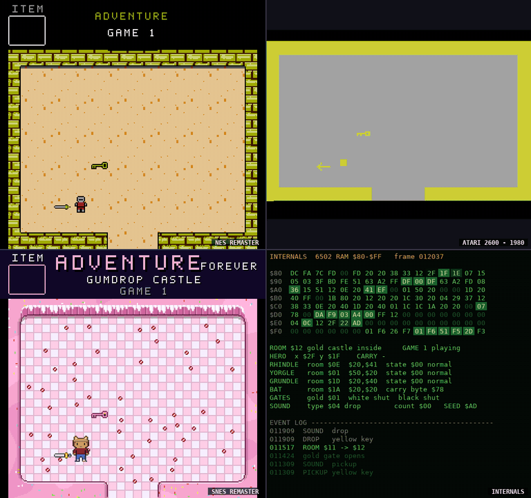

# Adventure Forever



▶️ **[Watch a full playthrough on YouTube](https://youtu.be/XRQrsM7X3kE)** (1:44): game 1 start to finish, switching looks,
casts, worlds and views along the way.

Atari 2600 **Adventure** (Warren Robinett, 1980) running *unmodified* in an emulator, with every frame
redrawn live from the game's 128 bytes of RAM, in four new **looks**:

- **NES**: an 8-bit remaster.
- **SNES**: a 16-bit remaster.
- **VGA**: an early-90s PC adventure: 256 colours picked for each world, a grey menu strip and message boxes.
- **Paper**: drawn in crayon in a spiral-bound sketchbook: a box of crayons, the paper's grain through the wax,
  handwriting, and messages on index cards.

Who's in the game and where it happens come in **packs**. Two ship with it, and any look shows either:

- **classic**: a knight, three dragons, the bat and the chalice, in brick and stone castles.
- **pbj**: PBJ in her bear-ear hat, Alice the Scottish terrier, who stretches into a bridge, a Yeti, a
  giant hen and a swamp Bog for dragons, a magpie that steals things, and the Storybook to bring home, in
  candy, ice and fire kingdoms.

You can mix them: the knight in the candy kingdom, PBJ in the brick castles, either on either console.

Each look also **sounds** like its console: the game's six sounds (picking up, dropping, a dragon's roar, being
eaten, a dragon dying, the win), and the castle gates rattling open and shut, as NES chip blips, soft SNES
bells and growls with echo, PC FM beeps, or a toy xylophone, kazoo and slide whistle on paper. Each dragon has
its own voice - Rhindle high and quick, Grundle deep and slow; in the pbj pack the hen squawks and the Bog
gurgles - and you hear them stomping towards you. The
2600-only view plays the original's sounds. Turn the music off (**M**) and you hear the world instead - a
summer day in the meadow, birds in the woods, drips in the catacombs - with your footsteps and the bat's wings.

The original 2600 picture can run alongside, and a four-way grid shows your game, a comparison (by default
the other console), the original, and the game's live RAM at once
(**[how to read the live RAM view →](docs/reading-the-ram.md)**). Gameplay is 100% the original: the emulator
runs the real game, and the remasters only *draw* it.

Why this exists, and why it was built with an AI assistant: [BACKGROUND.md](BACKGROUND.md).

## ⬇️ Download

| | |
|---|---|
| **macOS** (Apple Silicon: M1 and later) | [Adventure-Forever-macos-arm64.zip](https://github.com/majonesmax/adventure-forever/releases/latest/download/Adventure-Forever-macos-arm64.zip) |
| **Windows** (64-bit) | [Adventure-Forever-windows-x64.zip](https://github.com/majonesmax/adventure-forever/releases/latest/download/Adventure-Forever-windows-x64.zip) |

Unzip, start **Adventure Forever**, and drag your own Adventure ROM onto the window the first time (it's
remembered; the ROM isn't included). In the game, press **H** for all the keys ([Controls](#controls)).

**The first launch** - the apps aren't signed (that costs a yearly fee), so your system asks once:

- **macOS:** double-click the app; macOS refuses to open it. Open **System Settings → Privacy & Security**,
  scroll down to *"Adventure Forever" was blocked*, click **Open Anyway** and confirm. From then on it opens
  normally. (Or, in Terminal, in the folder you unzipped: `xattr -dr com.apple.quarantine "Adventure Forever.app"`.)
- **Windows:** at *"Windows protected your PC"*, click **More info**, then **Run anyway**.

All versions and release notes: [Releases](https://github.com/majonesmax/adventure-forever/releases). Linux or
an Intel Mac: [run it from source](#running-it-from-source-macos-windows-linux).

## More packs

More casts and worlds can be added to the app. **[Shall we play a game?](https://github.com/majonesmax/shall-we-play-a-game)**
is a collection of demo packs, each with its own cast, scenery and soundtrack: *ORIENTATION*, an office floor that
goes on too long (best in the VGA look), and *SKETCHBOOK*, a world a boy draws in purple crayon as he walks
through it (best in the paper look).

To add a pack, download it (on GitHub: **Code → Download ZIP**) and **drag the zip or folder onto the game
window**: the game copies it into its packs folder and switches to it. Packs can contain code, so only add
packs from people you trust.

To make your own, describe it to an AI coding assistant and build it together: [making a pack](docs/making-a-pack.md#start-with-an-ai-assistant)
shows how, and [CLAUDE.md](CLAUDE.md) gives the assistant the rules.

## How it works

The 2600 has no screen memory; Adventure's whole world lives in 128 bytes of RAM: which room each object is
in, where, what you carry, what each dragon is doing. Every frame we read that RAM through the libretro API
and draw our own picture from it, using the ROM's own room and object tables (decoded at run time from your
ROM). So the remasters can't change how the game plays. Room-to-room scrolls pause the emulator while they
slide, so the game's timing is untouched too.

| Folder | What's in it |
|---|---|
| `engine/` | the game itself: the emulator, the game's state (`GameState`), the RAM map and ROM tables, the music |
| `looks/` | how it's drawn (the consoles): the look contract (`base.py`), the NES, SNES, VGA and paper looks, a template |
| `content/` | what's drawn: casts (who) and worlds (where), loaded from packs |
| `packs/` | the packs: `pack.json`, `cast/` pictures and `world/` tiles each (`classic`, `pbj`, `template`) |
| `app/` | the window: views, room scrolls, recording, the live RAM panel |
| `shared/` | pixel-art helpers, palettes, the pixel font |
| `tools/` | the art pipeline, the video editor, viewers |
| `tests/` | checks against the real emulator, including pixel-exact "golden" tests of every look |

**[How it all fits together →](docs/ARCHITECTURE.md)** (and for emulation people - accuracy, timing, which ROMs: [Go outside, nerd](GO-OUTSIDE-NERD.md))

## Running it from source (macOS, Windows, Linux)

Needs Python 3.10 or newer.

```sh
python -m venv .venv
source .venv/bin/activate              # Windows: .venv\Scripts\activate
pip install -r requirements.txt
python tools/get_core.py               # downloads the Stella emulator core for your system into cores/
python play.py                         # drag your ROM onto the window the first time - or: python play.py path/to/adventure.a26
```

**Which ROM:** the NTSC release of Adventure (Atari CX2613, also sold by Sears), MD5
`157bddb7192754a45372be196797f284` - every good dump of that cartridge is identical. Other versions (the PAL
release, hacks) still run, and the game tells you what it found and whether the remasters can follow it
(`engine/versions.py`).

More: `python play.py --list` (the looks and packs), `--look snes --cast classic`, `--grid`, `--help`.
On Linux, sound needs your distribution's PortAudio (e.g. `libportaudio2`).

The grid shows what you're playing over a comparison (by default the other console with the same cast and world); in the grid, L / C / W change only your game, and Shift+L / C / W only the comparison. Details: [Controls](#controls).

**Building the downloads:** `python package/build.py` on each system makes that system's download in
`package/dist/` (PyInstaller can't build for another system). GitHub does it for Windows and macOS: the
"Downloads" workflow (`.github/workflows/downloads.yml`) builds both and runs each with `--check` (it plays
itself for a few seconds and says whether it works). Run it from the Actions tab to try a build; push a tag to
make a release:

```sh
git tag v1.3 && git push origin v1.3
```

The release gets both zips and `SHA256SUMS.txt`. Its notes are what's new, from
`package/release-notes/<tag>.md` (a first line `# <name>` becomes the title: "Adventure Forever 1.3: <name>"),
then the same download section every time (`package/release-notes/download.md`), then the checksums.

## Controls

In the game, **H** shows all of these.

| Key | |
|---|---|
| **Play** | |
| `Arrows` | move |
| `Space` | fire: drop what you carry |
| `Tab` | game select (games 1-3) |
| `Enter` | game reset: start |
| **What you see** | |
| `L` | next look: NES, SNES, VGA, paper |
| `C` | next cast: the knight, PBJ and friends |
| `W` | next world: castles, kingdoms |
| `I` | which look, cast and world |
| `V` | view: side by side, look, 2600, grid (2600: the original's sound effects) |
| `Shift+L/C/W` | the grid's comparison: its own |
| `F` | fullscreen on / off |
| `T` | room scrolls on / off |
| **Sound** | |
| `M` | music on / off (off: the world's own sounds - birds and a breeze, drips in the catacombs) |
| `- / =` | music quieter / louder |
| `N` | next music source |
| **More** | |
| `S` | screenshot |
| `R` | record on / off (needs ffmpeg) |
| `D` | debug line: speed, room, render time |
| `P` | pause |
| `H` | help: every key |
| `Esc` | quit |

## Music

By default the game plays five original songs from `chiptune.py` (title, overworld, dungeon, final, win),
synthesised NES-style. To use your own, create `music/music.json` mapping areas to an NSF track or a WAV
file:

```json
{"title": {"nsf": "music/my.nsf", "track": 1}, "overworld": {"file": "music/overworld.wav"}}
```

Areas not listed fall silent; N switches between your config and the built-in songs.
`python -m engine.music --survey FILE.nsf` lists an NSF's tracks; NSF playback needs
game-music-emu (macOS: `brew install game-music-emu`; Linux: your package manager's libgme).

## Make your own look or cast

A **look** is the console: how the game is drawn (its colour rules, status bar and screens). A **cast** is
who's in the game, a **world** is where it happens; a **pack** is a folder of pictures with a cast, a world or
both. Any look shows any cast in any world, adapting the pictures to its own rules
([platform rules](docs/platform-rules.md)). Each has a small working example to run and copy:

- **A new pack** (your own heroes, villains, items and scenery, no code needed): copy `packs/template` to
  `private/packs/<name>` (git-ignored, so it stays yours) or `packs/<name>`, then `play.py --pack <name>`.
  **[Making a pack →](docs/making-a-pack.md)**
- **A new look** (an Amiga look, a C64 look...): start from `looks/template_look.py`
  (`play.py --look template`). **[Making a look →](docs/making-a-look.md)**

## Recording and making videos

R records every look (with the cast and world on screen) plus the 2600 picture as separate lossless videos, the audio as heard, and a
per-frame log of what happened (rooms, pickups, dragon fights, deaths, wins). `tools/make_video.py` cuts a take
into a 1080p video from an `edit.json` you write per take (ranges to keep, captions, cards); see its
docstring. Needs `ffmpeg`. `tools/make_gif.py` turns a stretch of a take into a four-way grid GIF (like the one
at the top), redrawn with the current looks.

## How this was made

This project was built with generative AI. Most of the code was written with Claude (Anthropic), working
with a human who played, tested and directed it.

All the art is pixel art kept as text in each pack's `source/` folder (one character per pixel), so it can be
read, edited and compared like code. Most of it was drawn that way from the start: PBJ and friends, the
knight, the items, the bat and the bridge, while the pbj world's kingdoms are painted by code. Three things
began as Stable Diffusion XL images, then were reduced to a few colours and converted to text art: the
classic world's wall and floor tiles, the dragons' shapes, and the pbj world's grass. The music is written
as notes in code.

## Credits and license

- **Adventure** © 1980 Atari, created by Warren Robinett. Not included: bring your own ROM. His hidden
  credit is shown faithfully, in the original's own graphic and colours.
- **Stella** emulator core (GPL-2.0), downloaded separately: https://github.com/stella-emu/stella
- Code: MIT (`LICENSE`). Original art and music: CC BY 4.0 (`LICENSE-ASSETS.md`).

A non-commercial fan project, not affiliated with or endorsed by Atari, Nintendo or anyone else.
