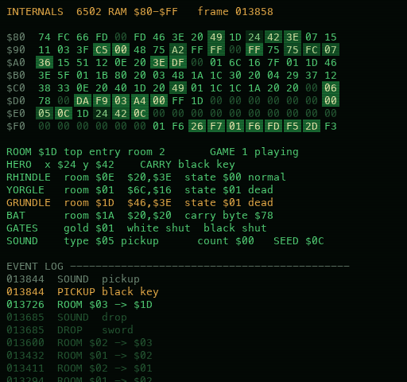

# Reading the RAM panel

The fourth quadrant of the grid view (**V** until you reach the grid) is the whole memory of the
Atari 2600 running Adventure: **all 128 bytes of RAM, live**. The 2600 has no other RAM, so these bytes
*are* the game: every room number, position, carried item and dragon mood is in here. The remasters
draw their pictures from exactly these bytes.



*A real frame from a game-1 run: PBJ has just picked up the black key in room `$1D`; Grundle and Yorgle
are both slain.*

## The four parts

### 1. The hex dump (top)

Eight rows of sixteen bytes, addresses `$80` to `$FF` (the label on the left is the address of the first
byte in the row; count across 0–F for the rest). Each byte is two hex digits, `00` to `FF`.

| What you see | Meaning |
|---|---|
| bright cell, fading | that byte just changed (the glow cools over about a second) |
| green | a byte holding a value |
| dim `00` | zero |

Watch it while you play: the hero's position bytes tick as you walk, the random seed (`$E5`) changes
constantly, and whole patches light up when a dragon wakes up or the bat flies past.

### 2. The decoded lines (middle)

The important bytes translated into words, every frame:

```
ROOM $1D top entry room 2       GAME 1 playing      <- $8A room, $DD game, $DE won?
HERO  x $24 y $42    CARRY black key                <- $8B, $8C, $9D
RHINDLE  room $0E  $20,$3E  state $00 normal        <- red dragon   $A4-$A8
YORGLE   room $01  $6C,$16  state $01 dead          <- yellow dragon $A9-$AD
GRUNDLE  room $1D  $46,$3E  state $01 dead          <- green dragon $AE-$B2
BAT      room $1A  $20,$20  carry byte $78          <- $CB-$CD, $D0
GATES    gold $01  white shut  black shut           <- $C8, $C9, $CA
SOUND    type $05 pickup   count $00   SEED $0C      <- $E0, $DF, $E5
```

A dragon's line turns **amber** when it's in your room, and **red** when it's attacking or has eaten
you. Rhindle, Yorgle and Grundle are the dragons' names from the original game. In the remasters
they're the red, yellow and green dragons (the Yeti, the hen and the Bog in the pbj pack).

### 3. The event log (bottom)

What changed, worked out by comparing each frame's RAM with the one before. The number is the frame
(60 per second). Newest is on top; the latest three are bright.

`ROOM $03 -> $1D` · `PICKUP black key` · `DROP sword` · `GRUNDLE normal -> ROAR` · `YORGLE enters the room`
· `black gate opens` · `SOUND pickup` · `WIN - THE CHALICE IS HOME!`

### 4. The DEADBEEF screen

When a dragon swallows you, the panel shows a covered wagon and **0xDEADBEEF**, with the real culprit in small
print. `DEADBEEF` is a hex number that reads as English, and programmers used to write it into unused or
freed memory so it would stand out when they read through a crash dump. The trigger is a dragon's state byte
becoming `$02` ("has eaten the hero"). It goes back to the RAM view when RESET revives you.

## The memory map

Everything below was taken from the commented disassembly of Adventure and checked against the running
game (`verify_ram.py`). Positions are the game's own units: x 0–159ish across, y counting **up** from the
bottom of the room.

### The hero and the game

| Address | Meaning | In the example |
|---|---|---|
| `$8A` `$8B` `$8C` | hero's room, x, y | room `$1D`, x `$24`, y `$42` |
| `$9D` | carried object, as *object number × 9*; `$A2` = nothing | `$75` = 13 × 9 = black key |
| `$9E` `$9F` | where the carried item sits relative to the hero | |
| `$E2` `$E3` `$E4` | last spot that didn't hit a wall (you bounce back to it) | `$1D`, `$24`, `$42` |
| `$92` | console switches as last read | |
| `$99` `$9B` | joystick: raw, and after removing blocked directions | |
| `$DD` | game: `$00` / `$02` / `$04` = game 1 / 2 / 3 | `$00` |
| `$DE` | `$00` while playing; `$FF` once the chalice is home (the win) | `$00` |
| `$DF` `$E0` | sound: countdown, and type (`0` win, `1` roar, `2` eaten, `3` dragon dies, `4` drop, `5` pickup) | count `$00`, type `$05` |
| `$E5` | the random seed (game 3 uses it to scatter the items) | `$0C` |

### The object list (`$A1`–`$D1`)

Robinett's object list: on RESET the game copies it from the ROM into RAM, and from then on every
movable thing lives here as **room, x, y** (dragons and the bat add **movement** and **state** bytes).

| Address | Object | In the example |
|---|---|---|
| `$A1`–`$A3` | the hidden grey dot | room `$15`, a dark maze room |
| `$A4`–`$A8` | red dragon (Rhindle): room, x, y, movement, state | room `$0E`, state `$00` |
| `$A9`–`$AD` | yellow dragon (Yorgle) | room `$01`, state `$01` |
| `$AE`–`$B2` | green dragon (Grundle) | room `$1D`, state `$01` |
| `$B3`–`$B5` | magnet | room `$1B` |
| `$B6`–`$B8` | sword | room `$03`, where it was dropped |
| `$B9`–`$BB` | chalice | room `$1C`, inside the black castle |
| `$BC`–`$BE` | bridge | room `$04`, in the blue maze |
| `$BF`–`$C1` | gold key | room `$12`, inside the gold castle |
| `$C2`–`$C4` | white key | room `$0E` |
| `$C5`–`$C7` | black key | room `$1D`, carried |
| `$C8` `$C9` `$CA` | gates: gold, white, black castle; `$1C` = shut | `$01`, `$1C`, `$1C` |
| `$CB`–`$CF` | bat: room, x, y, movement, state | room `$1A` |
| `$D0` `$D1` | what the bat carries (its own encoding, not decoded here), and how fed up it is | `$78` |

**Dragon states** (the fifth byte): `$00` normal, `$01` dead, `$02` has eaten the hero, `$03` and up
roaring, jaws open, attacking.

**Object numbers** (for `$9D`, which stores number × 9): `$09` sword, `$0A` bridge, `$0B` gold key,
`$0C` white key, `$0D` black key, `$0E` bat, `$0F` dot, `$10` chalice, `$11` magnet, `$12` nothing.

**Rooms worth knowing:** `$00` game select · `$11` gold castle (outside), `$12` inside ·
`$0F` / `$1A` white castle · `$10` / `$1B` black castle · `$04`–`$08` blue labyrinth ·
`$09`–`$0B` catacombs · `$13`–`$16` black maze · `$17`–`$19` red maze · `$1E` the secret room.

### The rest

| Address | Meaning |
|---|---|
| `$80`–`$89`, other unlabelled bytes | working storage: colours, positions copied for drawing the next frame, counters |
| `$F0`–`$FF` | **the CPU's stack**. On the 2600 the stack shares this same RAM, growing down from `$FF`. The `F3`, `F5`, `F6`, `F7` you see are halves of return addresses into the ROM (`$F000`–`$FFFF`), left behind as the code calls its subroutines. |

## Try it

- **Pick something up** and watch `$9D` jump to *object × 9*, then `$9E`/`$9F` lock the item's offset.
- **Walk through a door** and see `$8A` change, `ROOM $xx -> $yy` in the log, and the hero's y wrap
  from the top of the screen to the bottom.
- **Let a dragon see you:** its state byte races up through the roar values, and its line goes amber,
  then red.
- **Win** and `$DE` flips to `$FF`: the game's own "you won" flag, which the remasters' win screens use.
